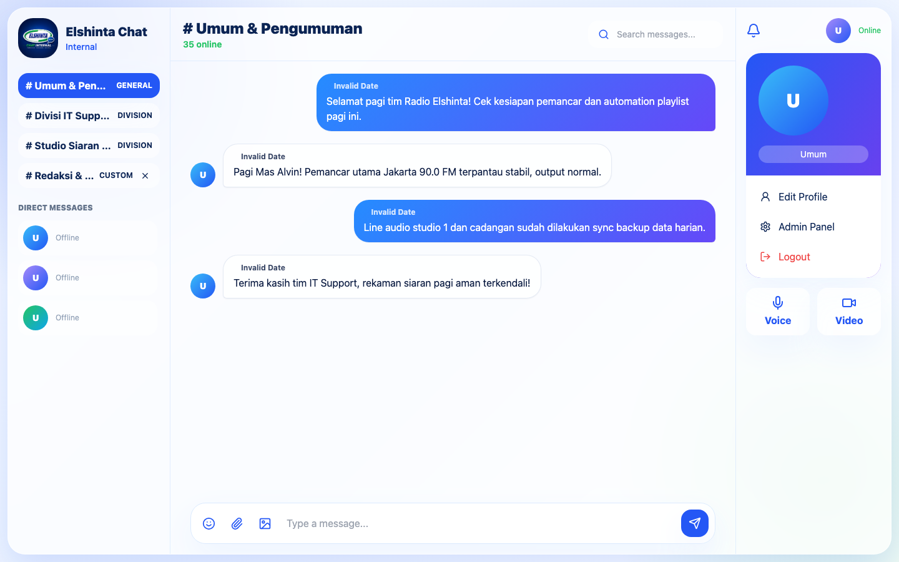
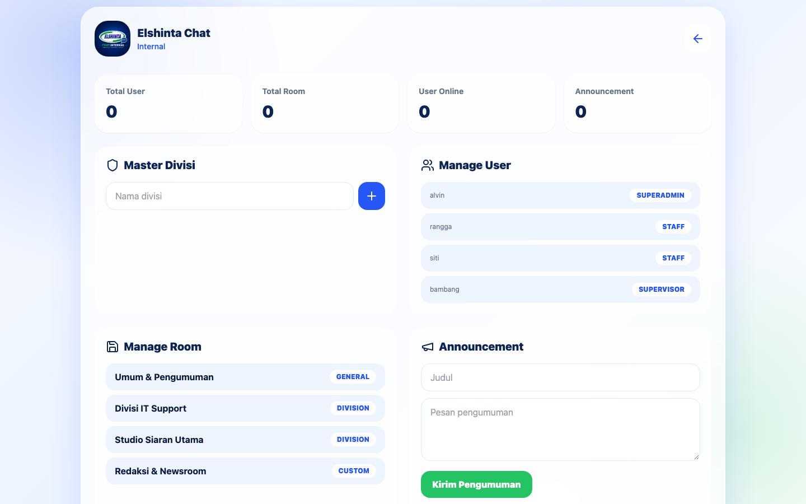
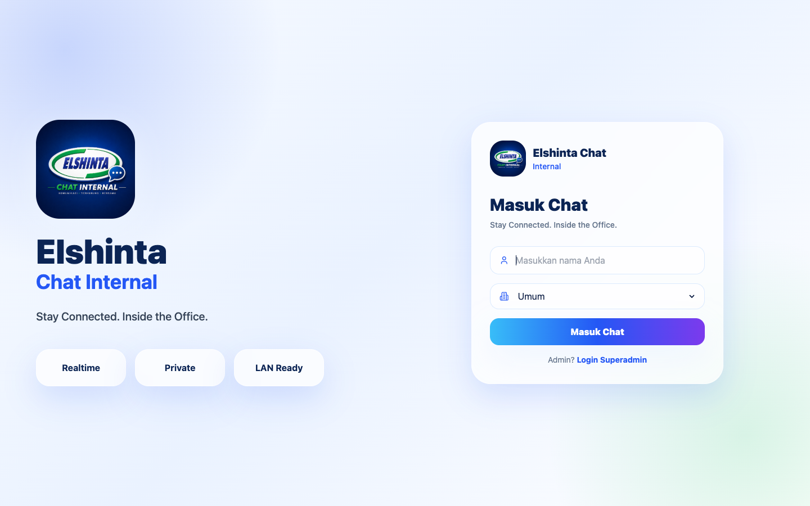

# 💬 Elshinta Chat Internal (Java Spring Boot Edition)
### Enterprise LAN Realtime Messaging & Voice/Video Call • Java 21 • Spring Boot 3 • WebSocket / STOMP • React • Vite

<p align="center">
  
</p>

Aplikasi komunikasi internal terenkripsi berbasis jaringan lokal (*Local Area Network / LAN*) yang dikembangkan khusus untuk seluruh staf dan divisi operasional **Radio Elshinta**. 

Sistem ini memungkinkan seluruh perangkat kantor (komputer studio siaran, jurnalis newsroom, divisi traffic promosi, dan tim IT Support) saling terhubung tanpa membutuhkan akses internet publik, menjaga kerahasiaan komunikasi data dan kelancaran koordinasi siaran 24/7.

---

## 📸 Preview & Screenshots

### 💬 Realtime Group & Direct Chat Room
<p align="center">
  
</p>

---

### 🛡️ Superadmin Panel (Room & User Management)
<p align="center">
  
</p>

---

### 🔐 User & Staff Login Portal
<p align="center">
  
</p>

---

## ✨ Fitur Utama

- **⚡ WebSocket STOMP Realtime Messaging**: Pertukaran pesan instan bebas lag dengan protokol STOMP over SockJS.
- **🏢 Multi-Type Chat Rooms**:
  - **Umum (General)**: Obrolan terbuka untuk seluruh karyawan radio.
  - **Divisi (Division)**: Ruang khusus tiap departemen (IT Support, Studio Siaran, Newsroom, Traffic).
  - **Ruang Kustom (Custom)**: Room tematik khusus proyek liputan tertentu.
  - **Direct Message (DM)**: Komunikasi privat 1-on-1 antar personal staf.
- **📞 Voice & Video Calling Ready**: Dukungan WebRTC signaling terintegrasi langsung di dalam antarmuka obrolan.
- **📢 Broadcast Announcements**: Notifikasi pengumuman instan dari Superadmin ke seluruh room yang sedang aktif.
- **📁 Local File & Media Sharing**: Pengiriman gambar, audio recording, dan dokumen lampiran tersimpan aman di server lokal LAN.
- **📶 Offline LAN Architecture**: Backend dan database dapat dijalankan pada IP server lokal (contoh: `192.168.100.x`) sehingga tetap berfungsi normal meski internet ISP padam.

---

## 🛠️ Tech Stack & Bahasa Pemrograman

| Layer | Teknologi | Peran & Deskripsi |
| :--- | :--- | :--- |
| **Backend Framework** | `Java 21 (LTS)`, `Spring Boot 3.4+` | Enterprise Grade REST API, Security, dan WebSocket Controller |
| **Realtime Messaging** | `Spring WebSocket`, `STOMP`, `SockJS` | Full-duplex bidirectional streaming communication |
| **Database & ORM** | `PostgreSQL / H2`, `Spring Data JPA (Hibernate)` | Relational persistence, migrations, dan query methods |
| **Keamanan & Auth** | `Spring Security 6`, `JWT (jjwt)` | Stateless JSON Web Token authentication & Role-Based authorization |
| **Frontend Framework** | `React 18`, `Vite` | Single Page Application berkecepatan tinggi dengan Tailwind & Lucide |
| **Realtime Client** | `@stomp/stompjs`, `sockjs-client` | Client-side websocket protocol connection |
| **Media & Audio/Video** | `WebRTC Signaling`, `Emoji-Mart` | Peer-to-peer audio calling and emoji reactions |

---

## 📁 Struktur Direktori

```text
elshinta-chat-springboot/
├── backend/
│   ├── src/main/java/com/elshinta/chat/
│   │   ├── config/            # WebSocketConfig, SecurityConfig, CorsConfig
│   │   ├── controller/        # AuthController, ChatController, AdminController
│   │   ├── model/             # Entity: User, Room, Message, Announcement
│   │   ├── repository/        # Spring Data JPA Repositories
│   │   ├── security/          # JwtAuthenticationFilter & TokenProvider
│   │   └── service/           # Business logic & message dispatcher
│   ├── src/main/resources/
│   │   └── application.yml    # Database credentials, JWT secrets, and port
│   ├── pom.xml                # Maven dependencies & build lifecycle
│   └── mvnw                   # Maven wrapper executable
├── frontend/
│   ├── src/
│   │   ├── api/client.js      # Axios instance & token headers
│   │   ├── context/           # AuthContext & Session management
│   │   ├── pages/             # LoginPage, ChatPage, AdminPage, ProfilePage
│   │   └── styles/            # Theme, glassmorphism, responsive styles
│   ├── public/                # Logo Elshinta & static assets
│   ├── package.json
│   └── vite.config.js
├── screenshots/               # Screenshot dokumentasi sistem
├── elshinta-chat-byvins.png   # Official 3D emblem
└── README.md
```

---

## ⚙️ Prasyarat Sistem

- **Java JDK**: Versi `21` atau lebih baru
- **Maven**: Versi `3.8+` (atau menggunakan `./mvnw` bawaan proyek)
- **Node.js**: Versi `18.x` atau `20.x` LTS
- **Database**: PostgreSQL (atau mode H2 in-memory untuk uji coba cepat)

---

## 🚀 Panduan Instalasi & Menjalankan Lokal

### 1. Clone Repositori
```bash
git clone https://github.com/ahmadalvin92/elshinta-chat-java.git
cd elshinta-chat-java
```

### 2. Setup Backend (Spring Boot)
1. Masuk ke folder `backend`:
   ```bash
   cd backend
   ```
2. Periksa konfigurasi di `src/main/resources/application.yml` (sesuaikan kredensial database PostgreSQL Anda):
   ```yaml
   server:
     port: 8080
   spring:
     datasource:
       url: jdbc:postgresql://localhost:5432/elshinta_chat
       username: postgres
       password: your_password
     jpa:
       hibernate:
         ddl-auto: update
   ```
3. Jalankan aplikasi Spring Boot:
   ```bash
   ./mvnw spring-boot:run
   ```
   *Backend aktif di `http://localhost:8080`.*

### 3. Setup Frontend (React & Vite)
1. Buka terminal baru dan masuk ke direktori `frontend`:
   ```bash
   cd frontend
   npm install
   ```
2. Buat file `.env` untuk mengarahkan ke backend:
   ```env
   VITE_API_BASE_URL="http://localhost:8080"
   ```
3. Jalankan server pengembangan Vite:
   ```bash
   npm run dev -- --host 0.0.0.0
   ```
   *Akses melalui browser di [http://localhost:5173](http://localhost:5173) atau melalui IP jaringan LAN komputer Anda (misal: `http://192.168.100.x:5173`).*

---

## 🔑 Hak Akses Pengguna

| Peran | Wewenang |
| :--- | :--- |
| **SUPER_ADMIN** | Pengelolaan penuh: membuat divisi baru, menghapus room, broadcast pengumuman, manage staf |
| **ADMIN** | Pengelolaan room dan pengawasan pesan internal |
| **STAFF / USER** | Kirim pesan real-time, share berkas, voice/video call dengan rekan kerja |

---

## 👨‍💻 Author

**Ahmad Alvin Griffin**  
- GitHub: [@ahmadalvin92](https://github.com/ahmadalvin92)
- Komunitas: Radio Elshinta IT Support
- Lokasi: Jakarta, Indonesia
